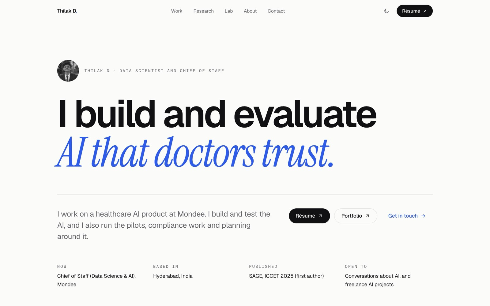
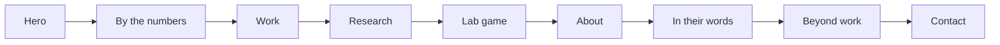
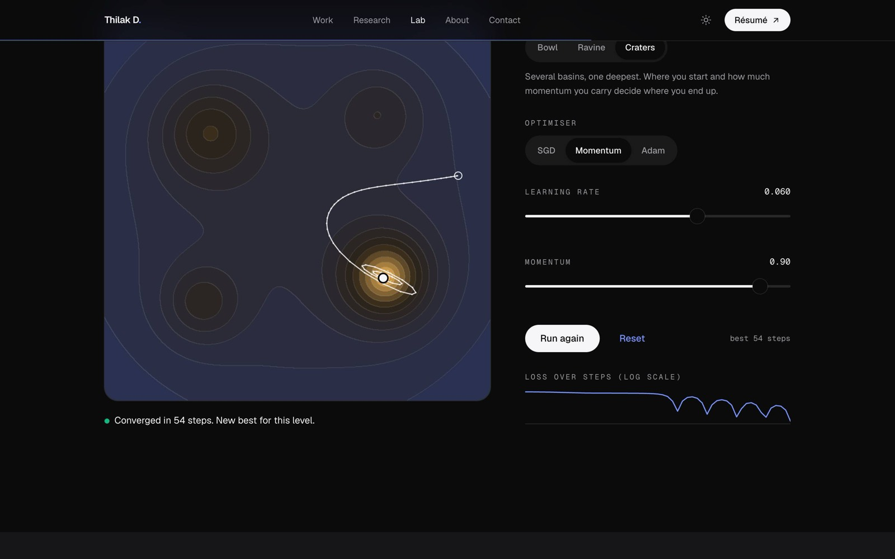
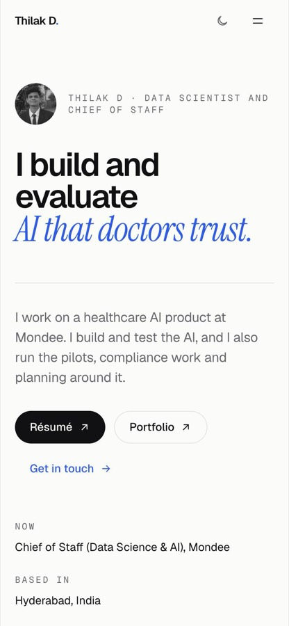
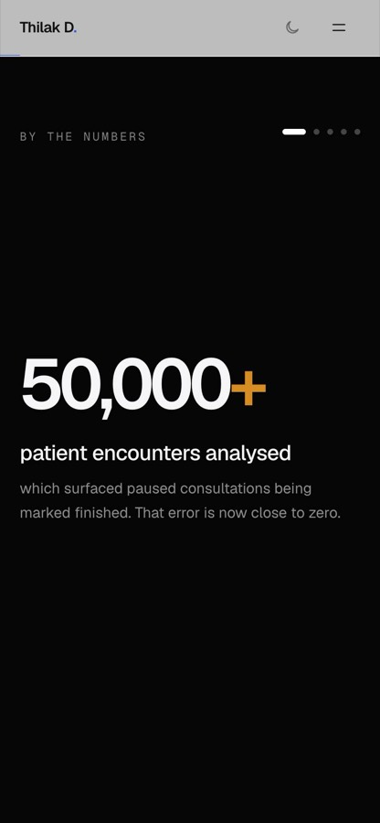

<div align="center">

# Thilak D · Portfolio

**Data Scientist and Chief of Staff. I build and evaluate AI that doctors trust.**

[](https://thilakd.vercel.app)
[](https://thilakd.vercel.app/resume/Thilak_D_Resume.pdf)
[](https://thilakd.vercel.app/resume/Thilak_D_Portfolio.pdf)


[**Tour**](#-take-the-tour) · [**Play the game**](#-play-the-lab-game) · [**Run it**](#-run-it-locally) · [**Update it**](#%EF%B8%8F-update-the-site-in-3-steps) · [**Under the hood**](#-under-the-hood)



</div>

---

## 🧭 Take the tour

One long page that reads top to bottom, like a product page:



<table>
  <tr>
    <td width="62%"></td>
    <td width="19%"></td>
    <td width="19%"></td>
  </tr>
  <tr>
    <td align="center"><sub>The lab, dark mode</sub></td>
    <td align="center"><sub>Phone</sub></td>
    <td align="center"><sub>Scroll-driven numbers</sub></td>
  </tr>
</table>

## 🎯 Play the lab game

Every model is a ball rolling down a loss surface. **[Try it on the live site →](https://thilakd.vercel.app/#lab)**

- [ ] **Bowl:** reach the minimum with plain **SGD**, then push the learning rate until it diverges
- [ ] **Ravine:** watch SGD crawl, then beat it with **Momentum** or **Adam**
- [ ] **Craters:** SGD always gets stuck in a side crater. Find the momentum that carries the ball to the deepest one

<details>
<summary><b>How it works</b></summary>
<br />

The landscapes and the three optimisers (SGD, Momentum, Adam) are plain TypeScript in [`lib/landscapes.ts`](lib/landscapes.ts), with no game library. The game finds the global minimum by grid search, then labels each run as **converged**, **stuck in a local minimum**, **too slow**, **diverged** or **out of steps**. The contour map is drawn on a `<canvas>` once per level, the game only loads when you scroll to it, and it pauses when off screen.

</details>

## 🚀 Run it locally

```bash
pnpm install
pnpm dev          # http://localhost:3000
```

<details>
<summary><b>All scripts</b></summary>
<br />

| Command          | What it does                            |
| ---------------- | --------------------------------------- |
| `pnpm dev`       | Local dev server with hot reload        |
| `pnpm build`     | Production build (types and lint enforced) |
| `pnpm start`     | Serve the production build              |
| `pnpm lint`      | ESLint                                  |
| `pnpm typecheck` | TypeScript, no emit                     |

</details>

## ✏️ Update the site in 3 steps

1. **Words:** edit [`lib/content.ts`](lib/content.ts). Every line of text on the site lives there.
2. **PDFs:** replace `public/resume/Thilak_D_Resume.pdf` and `public/resume/Thilak_D_Portfolio.pdf`. Keep the same filenames, so links never break.
3. **Ship:** push a branch and open a PR. Vercel builds a preview, and merging to `main` publishes it.

<details>
<summary><b>Where things live</b></summary>
<br />

```text
app/                 layout, page, OG image, sitemap, robots, icons
components/site/     page sections (hero, numbers, work, research, about, …)
components/lab/      the Gradient Descent game
lib/content.ts       all site copy
lib/landscapes.ts    loss functions and optimisers
public/resume/       résumé and portfolio PDFs
public/images/       photos and project images (compressed)
next.config.mjs      security headers
docs/screens/        README screenshots (not deployed)
```

</details>

## 🔍 Under the hood

<details>
<summary><b>Design system</b></summary>
<br />

Warm neutrals with one cobalt accent for actions and amber only for data. Geist for text, Geist Mono for numbers, Instrument Serif for the occasional accent. Fluid type, hairline dividers instead of cards, light and dark themes, and every animation respects *reduced motion*.

</details>

<details>
<summary><b>Performance</b></summary>
<br />

About 147 kB of JS on first load. Images are served as AVIF/WebP at the right size, the game loads only when you reach it, and the map loads only when you tap it. Lighthouse (mobile): **97 performance, 100 accessibility, 100 best practices, 100 SEO**.

</details>

<details>
<summary><b>Security and privacy</b></summary>
<br />

Strict Content Security Policy, HSTS, `frame-ancestors 'none'`, cross-origin isolation (no hotlinking of images or PDFs), a locked-down Permissions-Policy and a [`security.txt`](public/.well-known/security.txt). The PDFs are marked `noindex`, so search engines don't list them. Images can't be dragged out, long-pressed or right-clicked to save. Dependencies are pinned, and `pnpm audit` is clean.

</details>

---

<div align="center">
<sub>Designed and built by <a href="https://www.linkedin.com/in/thilak-d-129464205/">Thilak D</a> in Hyderabad · <a href="mailto:saithilak04@gmail.com">saithilak04@gmail.com</a></sub>
</div>
